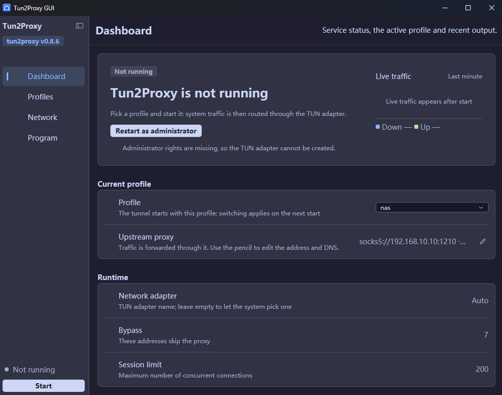
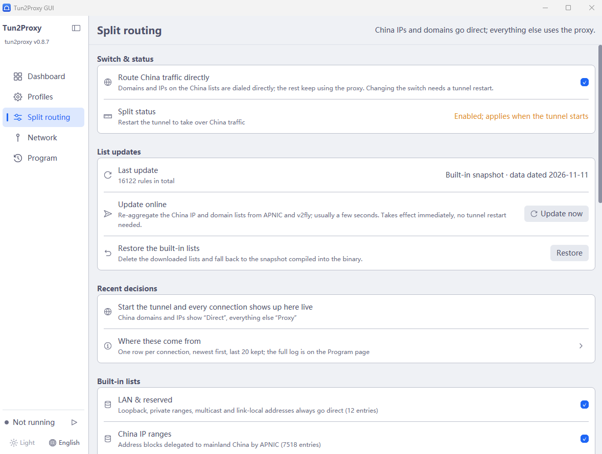

# tun2proxy GUI

**English** | [中文](README.md)

A cross-platform desktop front end for [tun2proxy](https://github.com/tun2proxy/tun2proxy),
written in Rust. The UI is built on
[GPUI](https://github.com/zed-industries/zed/tree/main/crates/gpui) (Zed's GPU-rendered
UI framework) and gpuikit (a shadcn-style component library for GPUI) — no WebView.
Colours, radii and control metrics all come from gpuikit's own themes (Catppuccin,
with Light / Dark / Follow-system).

The layout and interaction model were inspired by
[Paper-Dragon/tun2proxy-gui](https://github.com/Paper-Dragon/tun2proxy-gui), then
rebuilt around "multiple proxy profiles + one-click start/stop".



*English UI (Dashboard): navigation and service state always in the sidebar; live traffic
and routing, current profile and runtime options on the right.*



*English UI (Split routing): master switch and status, list update time, recent decisions,
and the built-in lists you can switch off row by row.*

## Features

- **Multiple proxy profiles**: keep as many as you like (home / office / a
  throwaway node), switch between them from a list, and create, duplicate,
  delete or rename them. The selected profile is what the tunnel starts with.
- **One-click start/stop**: the sidebar always shows the service state plus a
  start/stop button, so you can tell at a glance whether the tunnel is up.
- **China IP / domain direct routing**: a built-in snapshot of Chinese domains,
  IPv4 and IPv6 ranges decides what goes out over your local network and what
  keeps using the upstream proxy. Every built-in list row can be switched off on
  its own, and it coexists with both SOCKS5 and TProxy modes.
- **Online list updates**: one click on the split page re-aggregates the China IP
  and domain lists from APNIC and v2fly (showing the data date and entry counts),
  and "Restore" falls back to the built-in snapshot. Changes apply immediately —
  no tunnel restart.
- **Recent decisions**: the splitter writes one line per connection (direct /
  proxied / failed), and the dashboard carries the counts plus a trend chart, so
  you can see which connection went where.
- **Leftover adapter cleanup**: on startup the app removes `t2p_*` Wintun
  adapters left behind by a killed process — including non-present device nodes
  that never show up in "Network connections". Wintun adapters belonging to other
  VPNs are never touched.
- **Managed tun2proxy**: on first run, hit "Download and install" and the app
  fetches the official binary for your platform from GitHub Releases, verifies
  its SHA-256 and unpacks it into its own data directory. Later you can "Check
  for updates" and swap it in place — no need to ship a new GUI release.
- **Full option coverage**: upstream proxy (`socks5://` / `socks4://` /
  `http://`), DNS strategy (direct / virtual IP / over TCP, virtual IP by
  default), DNS servers, virtual address pool, bypass ranges, TUN adapter name
  (empty means a random `t2p_xxxxxxxx` each start), MTU, TCP/UDP timeouts, max
  sessions, IPv6 (on by default), auto route setup, UDPGW and log level.
- **Live log**: the child process's stdout/stderr is streamed straight into the
  window, and can be cleared with one click.
- **Proxy reachability check**: fill in the upstream URL, hit "Test", and the
  app opens a TCP connection and performs one handshake for the given protocol
  (SOCKS5 greeting / HTTP `CONNECT`). "Nothing is listening on that port", "the
  proxy wants authentication" or "connected, but the protocol is wrong" is
  written right on that row — no need to start the tunnel and guess from logs.
- **Pre-flight before start**: pressing "Start" runs the same handshake probe
  first. If the proxy is unreachable the app explains why in a dialog and does
  **not** launch the core, instead of spawning a tun2proxy that is bound to fail.
- **Chinese and English UI**: pick "Follow system / 中文 / English" in Settings —
  or click the "Language" cell at the bottom of the sidebar — applied immediately.
  Every string lives in code as
  `t("中文", "English")`, so there is no separate translation file to maintain.
- **Live traffic and routing**: one dashboard card holds two stacked line charts —
  both cover the last two minutes on a shared time axis with vertical units — and
  the routing chart carries direct / proxied / failed counters you can expand into
  a per-connection list.
- **System tray**: a tray icon is always present, with a tooltip that follows
  the service state. Its context menu can start, stop, show the window or quit;
  double-clicking the icon brings the window back.
- **Automatic elevation**: on Windows, if the app is not running as
  administrator it asks and then relaunches itself through UAC. On macOS/Linux
  it explains that root is required (on Linux you can enable "no root" mode to
  run inside a user namespace instead).

## Project layout

```
src/
├─ main.rs         Startup: privileges → DPI → config → engine → window
├─ core/           UI-independent core (no GUI framework dependency, testable on its own)
│  ├─ mod.rs       Module docs and re-exports
│  ├─ paths.rs     Where config / downloads / logs live
│  ├─ config.rs    Read, validate and convert proxy profiles into CLI args
│  ├─ binary.rs    Download / verify / unpack the official tun2proxy binary
│  ├─ engine.rs    Spawn the child process, collect logs, track state and progress
│  ├─ elevate.rs   Administrator / root detection and Windows auto-elevation
│  ├─ probe.rs     Upstream proxy reachability check (TCP + SOCKS5 / HTTP handshake)
│  ├─ traffic.rs   Sample TUN adapter byte counters by name (Windows interface table / /sys)
│  ├─ adapters.rs  Remove leftover t2p_* tunnel adapters before start (Windows SetupAPI)
│  ├─ split/       China-traffic direct routing
│  │  ├─ service.rs  Local SOCKS5 splitter: decisions, direct / proxied, counters and trend
│  │  ├─ rules.rs    Rules and matchers (domain suffix / keyword / CIDR)
│  │  ├─ library.rs  List aggregation: built-in snapshot + downloads + custom rules + per-row switches
│  │  ├─ builtin.rs  The list snapshot compiled into the binary
│  │  ├─ update.rs   Download and aggregate lists from APNIC + v2fly
│  │  ├─ outlet.rs   Detect and bind the direct-outlet adapter
│  │  ├─ upstream.rs Upstream proxy protocols (SOCKS5 / HTTP CONNECT)
│  │  ├─ ipset.rs    IP range set
│  │  └─ settings.rs Split settings
│  ├─ tray.rs      Tray icon (Windows: a dedicated message window + Shell_NotifyIcon)
│  ├─ window.rs    Find and show/hide the main window (tray restore, minimize to tray)
│  ├─ icon.rs      Multi-size bitmaps of the app icon (one copy for window and tray)
│  ├─ i18n.rs      Chinese/English strings and the language setting
│  └─ platform.rs  Process-level init (Windows DPI awareness)
└─ ui/             Presentation layer (GPUI + gpuikit)
   ├─ state.rs     App state, message enum, numeric input drafts
   ├─ view.rs      Root view: sidebar + content area
   ├─ theme.rs     Installs the gpuikit theme (swappable) and font-size constants
   ├─ sidebar.rs   Sidebar (title, service state, navigation, theme, language, start/stop)
   ├─ pages.rs     Content area: thin top bar + the grouped composition of each page
   ├─ cards.rs     Groups and rows for each page
   ├─ widgets.rs   Reusable text styles and widgets (hero card, group, setting row, pill)
   ├─ chart.rs     Line charts (gpui canvas): live traffic, routing, split trend
   └─ update.rs    Message handling (the only place that mutates state)
assets/
├─ icon.ico       App icon (multi-size, embedded into the exe resource section)
├─ icon.png       Icon source image (512×512, with alpha)
└─ screenshots/   UI screenshots used by the READMEs (Chinese and English)
tools/
└─ regen-rules/   Small tool that regenerates the builtin.rs list snapshot
build.rs          Compiles app.rc (icon + version info) into the Windows exe
```

### App icon

The exe resource section is the only source: `app.rc` + `build.rs`
(`embed-resource`) compile `assets/icon.ico` into the exe, and Explorer, the
taskbar and the window title bar all read it from there. GPUI does no runtime
icon loading, so the old "write the ico into the data directory" path is gone.

The icon is a multi-size ico (16/24/32/48/64/128/256); the system picks the
size it needs, so the small taskbar icon never turns to mush. To change the
icon, replace `assets/icon.ico` and run `cargo build` again.

### UI structure

```
┌──────────────┬──────────────────────────────────────┐
│ Tun2Proxy    │ Dashboard          Service state, …  │ ← thin top bar (~45dp)
│ tun2proxy …  │──────────────────────────────────────│ ← 1dp hairline
│              │  ╭──────────────────────────────────╮│
│ ▸ Dashboard  │  │ Live traffic / routing (2 min)   ││
│ ▸ Profiles   │  ╰──────────────────────────────────╯│
│ ▸ Split      │  Current profile                     │ ← group title (outside the card)
│ ▸ Network    │  ╭──────────────────────────────────╮│
│ ▸ Program    │  │ [▤] Profile         [ Default ⌄] ││ ← row
│              │  │     The tunnel starts with…      ││
│              │  ├──────────────────────────────────┤│ ← hairline inset on both sides
│              │  │ [⚙] Upstream  socks5://…   [✎]   ││
│              │  ╰──────────────────────────────────╯│
│ ● Service    │                                      │
│ [  Start  ]  │  Scrollable list of groups           │
└──────────────┴──────────────────────────────────────┘
```

Three visual layers: the sidebar uses `surface`, the content area `bg`, and cards
`surface` with a 1dp outline and 8dp radius. All three come from gpuikit's
semantic theme colours, so swapping the theme (see "Theme" below) repaints the
whole window — there is no hard-coded hex anywhere.

Setting rows: **the group title sits outside the card** (small bold text) and the
card holds one setting per row — icon on the left, "title + grey description" in
the middle, control or value on the right, with a hairline inset 12dp on both
sides between rows. Grouping related settings into one card is far denser than
one card per setting, and removes the wall of boxes.

The top bar is a single line (page name, one explanatory sentence on the right,
hairline at the bottom) instead of taking two rows. The dashboard hero card
(state pill + large title + primary action) is the first item in the content
flow. Only the group list scrolls; the top bar stays visible.

On the profile detail page (Profiles → pencil), the right side of the top bar
becomes a primary "Save to disk" button: when a form is long enough to scroll,
Save must not scroll out of view. The back button sits left of the title and
returns to the profile list.

Action results all go through one **notice bar** just under the top bar (green
for success, red for failure, amber when a start was blocked, dismissed with
the ✕ on its right), so saving a profile, copying the log or a refused start
gives feedback on every page — not only on the dashboard hero card. A success
notice clears itself after four seconds; an error stays until it is read.

The log pane grows a thin scrollbar on its right when the content overflows
(none is drawn otherwise), and its two corner icons copy the whole log and
clear it. Log timestamps are local wall-clock time.

Each of the five pages owns one group of settings (Dashboard / Profiles / Split routing /
Network / Program), and switching pages never loses anything you typed (all state lives
in `App`). The old "Advanced options"
page is gone: log level moved to "Program", UDP forwarding (UDPGW) to
"Network" — a page with three switches only adds a click.

The core notifies the UI exclusively through a repaint callback
(`Engine::set_rebuild_hook`), so `src/core` can be reused as-is if the UI is
ever ported to another framework.

## Building

```bash
cargo build --release
```

The binary lands in `target/release/tun2proxy-gui` (`tun2proxy-gui.exe` on
Windows).

The release profile is tuned for **size**, not build time (see
`[profile.release]` in `Cargo.toml`): `opt-level = "s"` + `lto = "fat"` +
`codegen-units = 1` + `panic = "abort"` + `strip = "symbols"`. On Windows the exe
drops from 14.9 MB to 7.6 MB and the packaged zip from 5.9 MB to 3.5 MB. It costs
a few minutes of full release build time (incremental rebuilds only relink), and
`panic = "abort"` means `cargo test --release` no longer works — run `cargo test`
with the default dev profile.

Dependencies:

- Windows: nothing extra.
- Linux: GPUI renders through Vulkan on Wayland / X11, so you need the matching
  development libraries and `pkg-config`; see gpui's own Linux notes for package
  names.
- macOS: the Xcode command line tools.

### Releasing

Pushing a tag builds every supported target and publishes them to GitHub
Releases (see `.github/workflows/release.yml`):

```bash
# Bump `version` in Cargo.toml, commit it, then tag — CI enforces that they match.
# Write the notes to a file and tag with -F: --cleanup=verbatim is required, or git
# strips lines starting with `#` (i.e. every `## heading`) as comments and the
# release page ends up with one undivided list.
git tag -a v0.5.0 -F notes.txt --cleanup=verbatim
git push origin v0.5.0
```

The first line of `notes.txt` is rendered **verbatim as the opening paragraph of the
release body** — the one-line summary, e.g. "0.4.0: direct routing for mainland IPs and
domains, automatic cleanup of leftover tunnel adapters". After a blank line comes the
rest of the body (`## sections` are fine). Write that first line as a self-contained
summary, not `v0.4.0` or `update`: the release title is always `Tun2Proxy GUI <tag>`, so
the first line never becomes the title, it only becomes that paragraph at the top.

Artifacts: `tun2proxy-gui-<tag>-<target>.zip` (Windows) and `.tar.gz` (Linux /
macOS, containing `Tun2Proxy GUI.app` on macOS), plus a `SHA256SUMS.txt`.
You can also run the workflow manually from the Actions page with the name of
an existing tag to republish (a rerun refreshes the release notes too).

Release notes come from the tag message; if the tag has no body, the version
bump commit's body is used instead. GitHub's generated changelog is not used:
this repo pushes straight to `main` without PRs, so `--generate-notes` only
ever produces a compare link.

## Network and proxies

Downloading/updating tun2proxy goes through the system `curl` (falling back to
`wget`, then PowerShell), so it **honours the standard `http_proxy` /
`https_proxy` environment variables**:

```bash
# Windows (cmd)
set http_proxy=http://127.0.0.1:7890
set https_proxy=http://127.0.0.1:7890
# Windows (PowerShell)
$env:http_proxy="http://127.0.0.1:7890"; $env:https_proxy="http://127.0.0.1:7890"
```

Then start the app from that same terminal. On failure the UI shows the actual
`curl` reason (`28` means timeout, `403` usually means a proxy blocked GitHub).
You can also download the release archive yourself and unpack its contents into
`bin/` inside the data directory.

## Split routing

With "Split routing → Route China traffic directly" enabled, starting the tunnel
also starts a local SOCKS5 splitter on `127.0.0.1`, and tun2proxy's upstream
points at it: connections that match the lists are dialled by the splitter itself
over your local network, everything else is forwarded to the real upstream proxy.
The two modes are independent — with split routing off, tun2proxy's command line
is byte-for-byte what it was before the feature existed.

**Where the lists come from.** A snapshot (Chinese domains plus APNIC's mainland
China IPv4 / IPv6 ranges, plus LAN and reserved addresses) is compiled into the
binary, so it works offline. "Update now" on the split page re-fetches and
re-aggregates from APNIC and v2fly, stores the result in the data directory and
shows its data date and entry count; "Restore the built-in lists" deletes the
download and falls back to the snapshot. A finished update is pushed into the
running tunnel immediately — no restart.

**How a decision is made.** Domains match by suffix / keyword (`qq.com` including
its subdomains), IPs match by CIDR. Custom rules are one per line
(`suffix:example.com`, `full:www.qq.com`, `keyword:bilili`, a bare `203.0.113.0/24`,
and `proxy:example.org` to force one domain back onto the proxy); they sit in front
of the built-in rules and can override them. Every built-in list row can be switched
off on its own; to stop using a custom rule, delete its line (a `#` starts a comment).

**Recent decisions.** The splitter writes one line per connection (direct /
proxied / failed, with domain, IP and the rule that matched). The split page keeps
the latest 20; the full log is on the Program page. The dashboard's routing chart
is the same data over a two-minute window, with direct / proxied / failed counters.

**Direct outlet.** The app picks the adapter carrying the current default route
(it has to be detected before tun2proxy starts, while the default route is still a
single clean entry); you can also type an adapter name or interface index. Windows
binds the socket with `IP_UNICAST_IF`, Linux with `SO_BINDTODEVICE`. **Other
platforms (macOS included) have no binding implementation: the splitter still
starts, but "direct" decisions fall back to the proxy**, and the log says that no
direct outlet was found.

## Data directory

| Platform | Path |
|----------|------|
| Windows | `%APPDATA%\tun2proxy-gui\` |
| macOS | `~/Library/Application Support/tun2proxy-gui/` |
| Linux | `~/.config/tun2proxy-gui/` (follows `$XDG_CONFIG_HOME`) |

Contents: `config.json` (all settings) and `bin/` (the downloaded tun2proxy,
`wintun.dll` and friends). Setting the `TUN2PROXY_GUI_HOME` environment
variable moves the whole directory elsewhere (portable mode).

`config.json` looks like this:

```json
{
  "profiles": [
    { "name": "Home SOCKS5", "proxy_url": "socks5://127.0.0.1:1080" },
    { "name": "Office HTTP", "proxy_url": "http://10.0.0.5:8080", "dns": "virtual" }
  ],
  "active": 0,
  "auto_check_update": true,
  "release_repo": "tun2proxy/tun2proxy",
  "language": "en",
  "theme": "light",
  "split": {
    "enabled": true,
    "local_networks": true,
    "china_ip": true,
    "china_domain": true,
    "custom": "suffix:example.com",
    "disabled": ["suffix:qq.com"],
    "direct_dns": "223.5.5.5",
    "direct_interface": ""
  }
}
```

`split` sits next to `profiles`: the rules describe "which sites should not use
the proxy", so switching proxies should not make you tick every list again.
`disabled` holds rows switched off individually (keys look like `suffix:qq.com`).

Missing fields fall back to defaults, so a hand-written config only needs the
keys you care about.

## Things to know before running

- tun2proxy creates a virtual network adapter and rewrites system routes, so it
  **requires administrator / root privileges**.
- The GUI neither bundles tun2proxy nor links against its libraries: the tunnel
  is entirely driven by the official binary, so GUI releases don't have to
  follow tun2proxy's release cadence.
- Stop the service before updating (on Windows a running exe cannot be replaced;
  the app blocks the attempt for you).
- "Start" probes the upstream proxy first (the same handshake as the "Test"
  button). If it can't connect, the core is never started and the dialog states
  the reason.
- Changing the split-routing **master switch** needs a tunnel restart; list updates
  and per-row switches are hot-reloaded and apply immediately.
- The tunnel adapter name is random on every start (`t2p_xxxxxxxx`); a leftover with
  the same prefix from a killed process is cleaned up at startup. Fill in a name on
  the Network page if you want it fixed.

## Tray and closing

- Closing the window opens a confirmation dialog whose **default button is
  "Minimize to tray"** (Enter accepts it): the tunnel keeps running and
  double-clicking the tray icon restores the window. To really quit, use the
  close button or press `Esc`.
- With "Ask on close" disabled in Settings, closing the window hides it into the
  tray without asking.
- Tray context menu: show window / start / stop / quit; the tooltip follows the
  service state.
- Windows only: tray support on other platforms needs their own system APIs and
  is not implemented yet. There, "minimize to tray" degrades to a plain exit, so
  the window can never be hidden where you can't get it back.

## Language

Settings offers "Follow system / 中文 / English"; the choice applies immediately
and is persisted (the `language` field). The "Language" row at the bottom of the
sidebar cycles System → 中文 → English in one click, with the same immediate
effect and persistence, and the dropdown in Settings follows. Strings live in
code (`t("中文", "English")`) — there is no separate translation resource file.

## Theme

Colours, radii and control heights all come from gpuikit's `Themeable` semantic
colours and `ControlScale`; this app does no colouring of its own. Light/dark is
decided in three places, highest priority first:

1. **The `TUN2PROXY_GUI_THEME` environment variable** (for debugging and
   screenshots — it pins light/dark regardless of everything else; when it is set,
   the sidebar "Theme" cell greys out and says so, since clicking changes nothing);
2. **Settings → "Program" → "Appearance" → "Theme"** (System / Light /
   Dark, applied immediately and saved), or **the "Theme" cell at the bottom of the
   sidebar** (clicking cycles Light → Dark → System; from System it jumps to the
   opposite of what you see now, so a click always changes something, and the
   dropdown follows);
3. **System** reads Windows' `AppsUseLightTheme` registry value.

The bottom of the sidebar is **one cell per setting, side by side**: **Theme** on
the left, **Language** on the right, each cell holding only an icon plus the
current value (the name lives in the tooltip), with the value at 12dp — side by
side leaves 78dp per cell and 58dp for text, where the Chinese label 「跟随系统」
is already 56dp at 14dp, so any font fallback would ellipsize it.

Each cell centres "icon + value", draws no divider (only a 4dp gap), and keeps
its own hover background, so only the cell under the pointer lights up.

```powershell
set TUN2PROXY_GUI_THEME=light    # Catppuccin Latte (light)
set TUN2PROXY_GUI_THEME=frappe   # Catppuccin Frappe
set TUN2PROXY_GUI_THEME=gruvbox  # gpuikit's signature Gruvbox Dark
```

An unknown name falls back to the default instead of failing (a typo in an
environment variable should not stop the app from starting). The Windows title
bar's light/dark mode follows the theme too (`core::platform::set_dark_titlebar`),
including when the theme changes at runtime — otherwise a dark UI on a
light-themed system keeps a white strip on top.

"System" only truly reads the OS preference on Windows; other platforms fall
back to dark.

Why not gpuikit's own default: Gruvbox is a warm brown background with a bright
green accent. That palette suits terminals and editors, but on a settings screen
full of small CJK text it does two things badly — the warm background makes text
look dingy, and the green ends up on the sidebar selection, the primary button
fill and all three chart lines at once. `ui::theme::tune` fixes three things:

1. **Re-layers Catppuccin.** gpuikit maps `surface` to mantle (darker than base),
   so cards would sink into the background. Here it becomes background base <
   card surface0 < button surface1.
2. **Inputs get a darker fill and a brighter outline.** gpuikit makes inputs the
   same colour as the card and distinguishes them by a 1dp outline alone, which
   is nearly invisible on a screen full of cards.
3. **Dark themes' outline is lightened by one step**, so 1dp controls hold up.

The primary button is not accent-filled: accent belongs to selection, focus and
data, and a solid block of it on a button keeps pulling the eye back. The primary
button stands up by contrast instead — light fill with dark text on dark themes,
automatically inverted on light ones, with no per-theme branch.

## Tray

The tray icon changes colour with the service: **grey when stopped (lights out),
original colour while running**. The tray is 16–32px, so shape cannot express
"running or not" and colour is the fastest signal (the hover tooltip carries the
state too). The 8dp status dot in the sidebar follows the same rule — grey when
stopped, green while running, amber in between, red on failure
(`status_dot_color`) — while its text stays in the foreground colour: a dot is a
graphic, 3:1 is enough, and greying the whole row is what actually hurts.

Both variants come from the single `assets/icon.ico`, with no extra image files:
the frames are PNG, so when stopped the icon is decoded, its saturated pixels are
desaturated and darkened, and re-encoded into an `HICON`
(`core::icon::recolor_pixel`); while running the embedded frame is used directly,
skipping the decode. The white motif is achromatic and only dimmed slightly —
otherwise the glyph and the grey background would smear together at 16px.

"Starting" counts as running: the user already pressed start, so the icon should
light up then; waiting for `Running` would feel like a dead click. If tinting
fails the original icon is used — a wrong colour is minor, a missing icon is not.

## Development

```bash
cargo check        # type check
cargo test         # unit tests: config, split rules and list aggregation, traffic sampling, chart ticks
cargo build        # debug build
```

Set `TUN2PROXY_GUI_NO_ELEVATE=1` to skip elevation and start with the current
privileges.

### Capturing a window while debugging

Use `PrintWindow(hwnd, hdc, PW_RENDERFULLCONTENT)` to ask the window for its
pixels; do **not** use `CopyFromScreen`. While debugging the window is often
covered by another app, so a screen capture returns that app's pixels — which
looks exactly like "the UI never updated" when in fact the wrong window was
captured.

`GetWindowRect` includes the invisible shadow border Windows 11 adds (about
11px left/right, 10px at the bottom), so inset by that much or desktop pixels
leak into the image. Clicks can be delivered with `PostMessage` of
`WM_LBUTTONDOWN` / `WM_LBUTTONUP` to the window handle (client-area coordinates),
which needs no foreground window.

### Three layout traps

1. **Wrapping text needs `flex_1 + min_w_0`**: without it, inline text is measured
   at the widest unbreakable word and CJK ends up as a vertical strip of
   characters. See `setting_row` in `src/ui/widgets.rs`.
2. **Hand-drawn controls must take `theme.control(size)`**: buttons, icon buttons
   and badges all size themselves from gpuikit's `ControlScale`; anything drawn
   by hand should read the same numbers, or the row ends up mismatched. See
   `primary_button` in `src/ui/widgets.rs`.
3. **Cards use a single outline**: `bg(surface) + border_1(border) +
   rounded(0.5rem)`, matching gpuikit's `Card`. Do not wrap a fill in an outer
   outline box — under a dark theme that leaves a bright rim around every card.

## License

MIT — see [LICENSE](LICENSE) for the full text.
