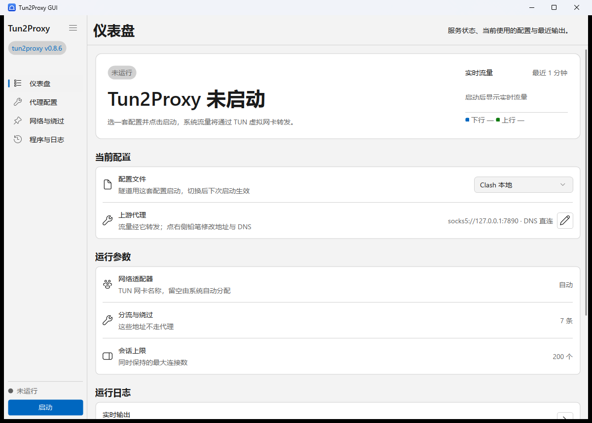

# tun2proxy GUI

[English](README.en.md) | **中文**

tun2proxy 的跨平台桌面图形前端，用 Rust 编写，界面基于
[ZSUI](https://github.com/qiu7824/zsui)（Rust 原生桌面 UI，不依赖 WebView）。

界面层级与交互参考了 [Paper-Dragon/tun2proxy-gui](https://github.com/Paper-Dragon/tun2proxy-gui)，
并按「多套代理配置 + 一键启停」重做了布局。



*中文界面（仪表盘）：左侧常驻运行状态与启停按钮，右侧是当前配置、运行参数与实时日志。*

## 功能

- **多套代理配置**：保存任意多套配置（家里 / 公司 / 临时节点），列表里一键切换，
  支持新建、复制、删除、改名；启动时使用当前选中的那套。
- **一键启停**：状态常驻左侧边栏（运行状态 + 启动/停止按钮），随时能看到是否在运行。
- **自动管理 tun2proxy**：首次运行点「下载并安装」，程序会从 GitHub Release
  下载对应平台的官方二进制、校验 SHA-256、解压到自己的数据目录；之后可随时
  「检查更新」并原地替换（不必重新发布本程序）。
- **完整参数覆盖**：上游代理（`socks5://` / `socks4://` / `http://`）、DNS 策略
  （直连 / 虚拟 IP / 走 TCP）、DNS 服务器、虚拟地址池、绕过网段、TUN 名称、
  MTU、TCP/UDP 超时、最大会话数、IPv6、自动配置路由、UDPGW、日志级别。
- **实时日志**：子进程的 stdout/stderr 直接显示在界面里，可一键清空。
- **代理连通性检测**：填完上游地址点一下「检测」，程序自己建立 TCP 连接并按
  协议走一次握手（SOCKS5 问候 / HTTP `CONNECT`），把「端口没在监听」「代理
  要求认证」「连上了但协议不对」直接写在那一行里——不用等启动失败再猜。
- **启动前自动预检**：点「启动」时先按同一套握手探一次上游代理，连不通就直接
  弹窗说明原因并**不启动**内核，而不是拉起一个注定失败的 tun2proxy 让用户自己
  看日志。
- **中英文界面**：设置里可选「跟随系统 / 中文 / English」，切换立即生效。
  代码里每条文案都是 `t("中文", "English")`，没有单独的翻译文件要维护。
- **实时流量折线图**：仪表盘首屏卡右侧显示最近一分钟的下行/上行速率。
- **系统托盘**：托盘图标常驻，提示文字跟着运行状态变；右键菜单可启动 / 停止 /
  显示窗口 / 退出，双击图标唤回窗口。
- **自动提权**：Windows 上检测到没有管理员权限时，询问后用 UAC 重新拉起自己；
  macOS/Linux 需要 root 时会给出提示（Linux 可开启「免 root」用用户命名空间运行）。

## 目录结构

```
src/
├─ main.rs         启动流程：权限 → DPI → 配置 → 引擎 → 窗口
├─ core/           与界面无关的内核（不依赖 zsui，可单独测试）
│  ├─ mod.rs       模块说明与再导出
│  ├─ paths.rs     配置 / 下载 / 日志的存放位置
│  ├─ config.rs    多套代理配置的读写、校验、转成命令行参数
│  ├─ binary.rs    下载 / 校验 / 解压 tun2proxy 官方二进制
│  ├─ engine.rs    拉起子进程、收日志、维护状态与更新进度
│  ├─ elevate.rs   管理员 / root 权限检测与 Windows 自动提权
│  ├─ probe.rs     上游代理连通性检测（TCP + SOCKS5 / HTTP 握手）
│  ├─ traffic.rs   采样子进程的收发字节数（Windows IO 计数器 / /proc）
│  ├─ tray.rs      系统托盘图标（Windows：独立消息窗口 + Shell_NotifyIcon）
│  ├─ window.rs    主窗口查找与显隐（托盘唤回、最小化到托盘）
│  ├─ icon.rs      程序图标的多尺寸位图（窗口 / 托盘共用一份数据）
│  ├─ i18n.rs      中英文文案与语言设置
│  └─ platform.rs  进程级初始化（Windows DPI 感知）
└─ ui/             界面层（zsui）
   ├─ state.rs     应用状态、消息枚举、数字输入草稿
   ├─ view.rs      整棵视图树：左侧边栏 + 右侧内容区
   ├─ sidebar.rs   左侧边栏（标题、运行状态、导航、启动/停止）
   ├─ pages.rs     右侧内容区：细顶栏 + 各页的分组组合
   ├─ cards.rs     各页的分组与行
   ├─ widgets.rs   可复用的文字样式与小部件（首屏卡、分组、设置行、胶囊）
   ├─ chart.rs     实时流量折线图（zsui canvas）
   └─ update.rs    消息处理（唯一修改状态的地方）
assets/
├─ icon.ico       程序图标（多尺寸，编进 exe 资源）
└─ icon.png       图标原图（512×512，带透明通道）
build.rs         把 app.rc（图标 + 版本信息）编进 Windows exe
```

### 程序图标

两条路各管一边，互不依赖：

- **资源管理器 / 任务栏**：`app.rc` + `build.rs`（`embed-resource`）把
  `assets/icon.ico` 编进 exe 的资源段，这是 Windows 取图标的唯一来源；
- **窗口标题栏**：`core::paths::install_icon()` 把内嵌的 ico 写到数据目录，
  再把绝对路径交给 `native_window(..).icon_path(..)`（非 Windows 平台只走这条）。

图标本身是多尺寸 ico（16/24/32/48/64/128/256），系统按需挑一档，任务栏小图标
不会糊。换图标只需替掉 `assets/icon.ico` 后重新 `cargo build`。

### 界面结构

```
┌──────────────┬──────────────────────────────────────┐
│ Tun2Proxy    │ 仪表盘            服务状态、当前配置……  │ ← 细顶栏（约 45dp）
│ [v0.0.1]     │──────────────────────────────────────│ ← 1dp 发丝线
│              │  ╭──────────────────────────────────╮│
│ ▸ 仪表盘      │  │ [未运行]              [  启动  ] ││
│ ▸ 代理配置    │  │ Tun2Proxy 未启动                  ││
│ ▸ 网络与绕过  │  │ 一句说明……                        ││
│ ▸ 程序与日志  │  ╰──────────────────────────────────╯│
│              │  当前配置                             │ ← 分组标题（卡片外）
│              │  ╭──────────────────────────────────╮│
│              │  │ [▤] 配置文件          [ 默认  ⌄] ││ ← 行
│              │  │     隧道用这套配置启动……          ││
│              │  ├──────────────────────────────────┤│ ← 左右缩进的发丝线
│              │  │ [⚙] 上游代理    socks5://…  [✎]  ││
│              │  ╰──────────────────────────────────╯│
│ ● 服务状态    │                                      │
│ [  启动  ]    │  可滚动的分组列表（溢出时才出滚动条）    │
└──────────────┴──────────────────────────────────────┘
```

视觉分三层：侧边栏白底，右侧内容区浅灰底（`Surface`），卡片白底 + 1dp 描边 +
12dp 圆角——白卡片落在灰底上自然浮起来，相邻模块靠间距与描边区分，不靠分隔线。

设置项的版式照 Windows 11 任务管理器：**分组标题在卡片外**（加粗小字），卡片里是
一行一个设置项——左边图标、中间「标题 + 灰说明」、右边控件或值，行与行之间夹一条
左右缩进 14dp 的发丝线。同一类设置收进一张卡，比「一卡一项」密得多，也少了满屏的框。

顶栏只有一行（页面名 + 右侧一句说明 + 底部发丝线），不再占两行高度；
仪表盘的首屏卡片（状态胶囊 + 大标题 + 主操作）放在内容流的第一位。
右侧只有分组列表是滚动区，顶栏始终可见。

配置详情页（代理配置 → 铅笔）的顶栏右侧换成「保存到磁盘」主按钮：字段多到
要滚动时，保存不能跟着内容跑出屏幕；返回按钮在标题左边，回到配置列表。

四个页面各管一组设置，切换页面不会丢失任何已填内容（状态都在 `App` 里）。
原来的「高级选项」页已拆掉：日志级别进「程序与日志」，UDP 转发（UDPGW）进
「网络与绕过」——一个只有三个开关的页面只多一次点击，不省事。

内核层只通过「重绘回调」通知界面刷新（`Engine::set_rebuild_hook`），因此把界面
换成别的框架时，`src/core` 可以原样复用。

## 构建

```bash
cargo build --release
```

产物在 `target/release/tun2proxy-gui`（Windows 为 `tun2proxy-gui.exe`）。

依赖说明：

- Windows：无需额外依赖。
- Linux：ZSUI 走 `linux-direct` 后端（Cairo/Pango 自绘，不是 GTK 控件），需要
  `libcairo2-dev libpango1.0-dev libglib2.0-dev pkg-config`。
- macOS：需要 Xcode 命令行工具。

### 发布

打 tag 即自动编译三平台产物并发布到 GitHub Release（见
`.github/workflows/release.yml`）：

```bash
# 先把 Cargo.toml 的 version 改好并提交，tag 必须与它一致（CI 会校验）
git tag v0.1.1 && git push origin v0.1.1
```

产物：`tun2proxy-gui-<tag>-<target>.zip`（Windows）、`.tar.gz`（Linux /
macOS，macOS 里是 `Tun2Proxy GUI.app`），外加一份 `SHA256SUMS.txt`。
也可以在 Actions 页面手动 Run workflow，填一个已存在的 tag 重跑发布。

## 网络与代理

下载/更新 tun2proxy 走系统 `curl`（其次 `wget`、PowerShell），因此**认标准的
`http_proxy` / `https_proxy` 环境变量**：

```bash
# Windows（cmd）
set http_proxy=http://127.0.0.1:7890
set https_proxy=http://127.0.0.1:7890
# Windows（PowerShell）
$env:http_proxy="http://127.0.0.1:7890"; $env:https_proxy="http://127.0.0.1:7890"
```

设好后从同一个终端启动本程序即可。下载失败时界面会显示 `curl` 的具体原因
（`28` 是超时、`403` 多半是代理拦了 GitHub），也可以手动下载 Release 包，
把里面的文件解压到数据目录的 `bin/` 下。

## 数据目录

| 平台 | 路径 |
|------|------|
| Windows | `%APPDATA%\tun2proxy-gui\` |
| macOS | `~/Library/Application Support/tun2proxy-gui/` |
| Linux | `~/.config/tun2proxy-gui/`（遵循 `$XDG_CONFIG_HOME`） |

目录内容：`config.json`（全部配置）、`bin/`（下载的 tun2proxy 与 wintun.dll 等）。
设置环境变量 `TUN2PROXY_GUI_HOME` 可以把整个目录搬到别处（便携版）。

`config.json` 形如：

```json
{
  "profiles": [
    { "name": "家庭 SOCKS5", "proxy_url": "socks5://127.0.0.1:1080" },
    { "name": "公司 HTTP", "proxy_url": "http://10.0.0.5:8080", "dns": "virtual" }
  ],
  "active": 0,
  "auto_check_update": true,
  "release_repo": "tun2proxy/tun2proxy"
}
```

缺字段会按默认值补齐，因此手写配置文件时只需要写关心的几项。

## 运行须知

- tun2proxy 需要创建虚拟网卡并改系统路由，**必须有管理员 / root 权限**。
- 本程序不把 tun2proxy 编进自身，也不链接它的库：隧道完全由官方二进制完成，
  这样 GUI 的发布节奏不必跟着 tun2proxy 走。
- 更新前请先停止服务（Windows 上无法替换正在运行的 exe，程序会自动拦截）。
- 点「启动」时会先探一次上游代理（和「检测」按钮同一套握手），连不通就不启动，
  弹窗里直接写原因。

## 托盘与关闭

- 关窗口时弹确认框，**默认按钮是「最小化到托盘」**（回车即可）：隧道不断，
  点托盘图标双击可恢复窗口。想真退出就点右上叉或按 `Esc`。
- 设置里关掉「关闭时询问」后，关窗口直接藏进托盘，不再问。
- 托盘右键菜单：显示窗口 / 启动 / 停止 / 退出；提示文字随状态变。
- 只支持 Windows：其它平台的托盘需要各自的系统 API，目前没有实现，
  「最小化到托盘」在那些平台上会自动退化为直接退出（不会把窗口藏到找不回来）。

## 语言

设置页可选「跟随系统 / 中文 / English」，切换后立即生效并落盘（`language`
字段）。文案写在代码里（`t("中文", "English")`），没有单独的翻译资源文件。

## 开发

```bash
cargo check        # 类型检查
cargo test         # 配置管理的单元测试
cargo build        # 调试构建
```

调试用的截图脚本在 `.probe/shot.ps1`（仅 Windows）：`-Resize` 改窗口尺寸、
`-Click` 点一下、`-Wheel` 滚一下，然后用 `PrintWindow` 把窗口抓成 PNG，便于
检查布局。设置 `TUN2PROXY_GUI_NO_ELEVATE=1` 可跳过提权。

> 别用屏幕截图（`CopyFromScreen`）：调试时窗口不一定被合成到可见桌面上，
> 截出来会是别的应用。`PrintWindow(hwnd, hdc, 2)` 直接问窗口要画面，稳。

### 布局上的三个坑（zsui 0.3）

1. **文字换行要写进样式**：`ViewNode::text_wrap()` 只对多行输入框生效，对普通
   文字是空操作。要换行必须设 `SemanticTextStyle { wrap: TextWrap::Word, .. }`，
   见 `src/ui/widgets.rs` 的 `wrapped()`。否则长说明会一直单行、超出卡片后被
   窗口边缘裁掉。
2. **容器宽度取「最宽子项的自然宽度」**：没有 `width: 100%` 这种写法。要让卡片
   跟着窗口变宽，得给父级 `align(ViewAlign::Stretch)` + 子级 `flex(1.0)`（见
   `src/ui/widgets.rs` 的 `card()`）；反过来，可换行的文字放进 `row` 会被压成
   竖条，所以行内标签用 `caption_nowrap()`。
3. **装不下是裁剪，不是换行**：控件与文字永远不会被压到平台度量以下，容器比
   内在最小宽度还窄时右侧直接被切掉（`src/view/layout.rs` 的 hard-size
   contract）。所以窗口最小宽度 `ui::MIN_WINDOW_WIDTH` 必须大于「最宽那一页
   的内在最小宽度」——`ui::layout_probe::no_page_overflows_the_minimum_window`
   会盯着这条，往卡片里塞更宽的控件时测试会先报错，而不是让用户看到切边。

## 许可

MIT，全文见 [LICENSE](LICENSE)。
