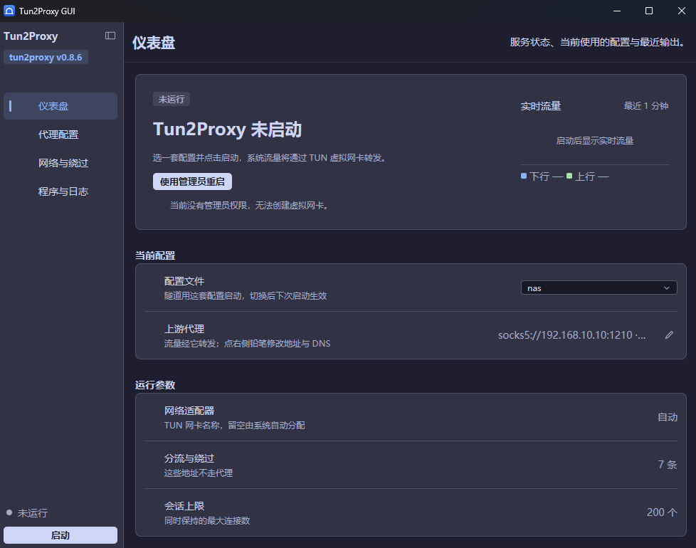
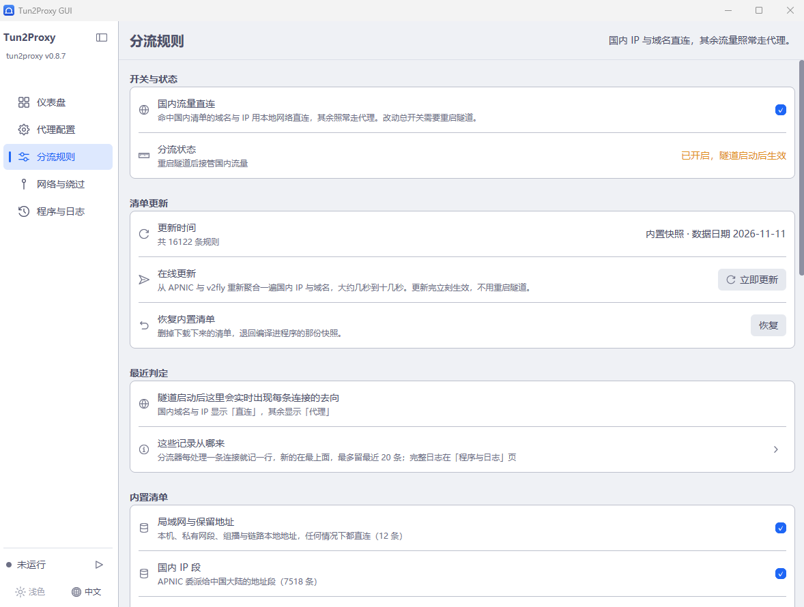

# tun2proxy GUI

[English](README.en.md) | **中文**

tun2proxy 的跨平台桌面图形前端，用 Rust 编写。界面基于
[GPUI](https://github.com/zed-industries/zed/tree/main/crates/gpui)（Zed 的 GPU 渲染
UI 框架）和 gpuikit（shadcn 风格的 GPUI 组件库），不依赖 WebView；配色、圆角、
控件尺度全部取自 gpuikit 自带的主题（Catppuccin，浅色 / 深色 / 跟随系统三选一）。

界面层级与交互参考了 [Paper-Dragon/tun2proxy-gui](https://github.com/Paper-Dragon/tun2proxy-gui)，
并按「多套代理配置 + 一键启停」重做了布局。



*中文界面（仪表盘）：左侧常驻导航与运行状态，右侧是实时流量与连接去向、当前配置与运行参数。*



*中文界面（分流规则）：总开关与状态、清单更新时间、最近判定，以及可以单独开关的内置清单。*

## 功能

- **多套代理配置**：保存任意多套配置（家里 / 公司 / 临时节点），列表里一键切换，
  支持新建、复制、删除、改名；启动时使用当前选中的那套。
- **一键启停**：状态常驻左侧边栏（运行状态 + 启动/停止按钮），随时能看到是否在运行。
- **国内 IP / 域名直连分流**：内置国内域名 / IPv4 / IPv6 清单快照，命中清单的流量
  用本地网络直连，其余照常走上游代理。内置清单的每一行可以单独开关，和 SOCKS5 /
  TProxy 两种模式并存，互不影响。
- **清单在线更新**：分流页点「立即更新」就从 APNIC + v2fly 重新聚合一遍国内 IP 与
  域名（显示数据日期与条数），也能一键退回内置快照；改完立即生效，不用重启隧道。
- **最近判定**：分流器每处理一条连接就记一行（直连 / 走代理 / 失败），仪表盘上还有
  直连 / 走代理 / 失败的计数与趋势图，哪条走了哪条一目了然。
- **残留网卡清理**：启动时把上次被强杀留下的 `t2p_*` Wintun 适配器（含「网络连接」
  里看不见的非在册设备节点）删掉；机器上别的 VPN 的 Wintun 适配器不碰。
- **自动管理 tun2proxy**：首次运行点「下载并安装」，程序会从 GitHub Release
  下载对应平台的官方二进制、校验 SHA-256、解压到自己的数据目录；之后可随时
  「检查更新」并原地替换（不必重新发布本程序）。
- **完整参数覆盖**：上游代理（`socks5://` / `socks4://` / `http://`）、DNS 策略
  （直连 / 虚拟 IP / 走 TCP，默认虚拟 IP）、DNS 服务器、虚拟地址池、绕过网段、
  TUN 网卡名（留空则每次启动随机生成 `t2p_xxxxxxxx`）、MTU、TCP/UDP 超时、
  最大会话数、IPv6（默认开）、自动配置路由、UDPGW、日志级别。
- **实时日志**：子进程的 stdout/stderr 直接显示在界面里，可一键清空；同一份日志
  用 `tracing` 按天写入数据目录下的 `logs/`（`tun2proxy-gui.YYYY-MM-DD.log`，保留
  最近 7 天），界面清空不影响已落盘的文件；panic 另记 `tun2proxy-gui.panic.log`。
  子进程那些行的时间戳会被换成本地时间（它自己打的是 UTC），整份文件一套时间；
  文件里只留子进程的 WARN 以上（每连接两行的 INFO 一天就是几百 MB），界面照旧
  全显示，另有「日志过滤」可一键摘掉子进程输出、只看分流判定。
- **代理连通性检测**：填完上游地址点一下「检测」，程序自己建立 TCP 连接并按
  协议走一次握手（SOCKS5 问候 / HTTP `CONNECT`），把「端口没在监听」「代理
  要求认证」「连上了但协议不对」直接写在那一行里——不用等启动失败再猜。
- **启动前自动预检**：点「启动」时先按同一套握手探一次上游代理，连不通就直接
  弹窗说明原因并**不启动**内核，而不是拉起一个注定失败的 tun2proxy 让用户自己
  看日志。
- **启停有明确的等待反馈**：按下「启动 / 停止」的下一帧整窗压一层遮罩 + 转圈，
  写明正在等哪一步（探上游、清残留网卡、起分流器、拉子进程），等这次启停有了
  结论才撤；这期间侧栏那颗按钮置灰，避免连点起两条检测线程。
- **中英文界面**：设置里可选「跟随系统 / 中文 / English」，侧栏底部也有一行
  「语言」可以点着切，切换立即生效。
  代码里每条文案都是 `t("中文", "English")`，没有单独的翻译文件要维护。
- **浅色 / 深色 / 跟随系统**：设置里三选一，侧栏底部还有一行「外观」可以点一下
  直接换（三档循环），两处都立即生效并落盘；「跟随系统」
  读 Windows 的浅色设置，原生标题栏一起跟着变。
- **实时流量与连接去向**：仪表盘首屏一张卡里三张折线图（下行流量、上行流量、连接
  去向），都是最近 2 分钟、时间轴对齐、带纵向单位。流量按方向拆成两张，每张再按
  「直连 / 代理」堆叠成两条色带（数据来自分流器的实际收发字节）：上下行差着两个
  数量级，合成一张会把上行压成贴着底边的一根线，所以各自按自己的峰值定纵轴。图例
  给出两条路各自的上下行速率；连接去向图下面是直连 / 走代理 / 失败的计数，点开还能
  看逐条判定。
- **系统托盘**：托盘图标常驻，提示文字跟着运行状态变；右键菜单可启动 / 停止 /
  显示窗口 / 退出，双击图标唤回窗口。
- **自动提权**：Windows 上检测到没有管理员权限时，询问后用 UAC 重新拉起自己；
  macOS/Linux 需要 root 时会给出提示（Linux 可开启「免 root」用用户命名空间运行）。

## 目录结构

```
src/
├─ main.rs         启动流程：权限 → DPI → 配置 → 引擎 → 窗口
├─ core/           与界面无关的内核（不依赖 GUI 框架，可单独测试）
│  ├─ mod.rs       模块说明与再导出
│  ├─ paths.rs     配置 / 下载 / 日志的存放位置
│  ├─ logs.rs      运行日志（tracing）：按天落盘、同时推给界面
│  ├─ config.rs    多套代理配置的读写、校验、转成命令行参数
│  ├─ binary.rs    下载 / 校验 / 解压 tun2proxy 官方二进制
│  ├─ engine.rs    拉起子进程、收日志、维护状态与更新进度
│  ├─ elevate.rs   管理员 / root 权限检测与 Windows 自动提权
│  ├─ probe.rs     上游代理连通性检测（TCP + SOCKS5 / HTTP 握手）
│  ├─ traffic.rs   按 TUN 网卡名采收发字节数（Windows 接口表 / /sys）
│  ├─ adapters.rs  启动前清理残留的 t2p_* 隧道网卡（Windows SetupAPI）
│  ├─ split/       国内流量直连分流
│  │  ├─ service.rs  本机 SOCKS5 分流器：判定、直连 / 转发、计数与趋势
│  │  ├─ rules.rs    规则与匹配器（域名后缀 / 关键字 / IP 段）
│  │  ├─ library.rs  清单聚合：内置快照 + 已下载清单 + 自定义规则 + 单行开关
│  │  ├─ builtin.rs  编进二进制的清单快照
│  │  ├─ update.rs   从 APNIC + v2fly 下载并聚合清单
│  │  ├─ outlet.rs   直连出口网卡探测与绑定
│  │  ├─ upstream.rs 上游代理协议（SOCKS5 / HTTP CONNECT）
│  │  ├─ ipset.rs    IP 段集合
│  │  └─ settings.rs 分流设置
│  ├─ tray.rs      系统托盘图标（Windows：独立消息窗口 + Shell_NotifyIcon）
│  ├─ window.rs    主窗口查找与显隐（托盘唤回、最小化到托盘）
│  ├─ icon.rs      程序图标的多尺寸位图（窗口 / 托盘共用一份数据）
│  ├─ i18n.rs      中英文文案与语言设置
│  └─ platform.rs  进程级初始化（Windows DPI 感知）
└─ ui/             界面层（GPUI + gpuikit）
   ├─ state.rs     应用状态、消息枚举、数字输入草稿
   ├─ view.rs      根视图：左侧边栏 + 右侧内容区
   ├─ theme.rs     装载 gpuikit 主题（可换肤）与字号常量
   ├─ sidebar.rs   左侧边栏（标题、运行状态、导航、外观、语言、启动/停止）
   ├─ pages.rs     右侧内容区：细顶栏 + 各页的分组组合
   ├─ cards.rs     各页的分组与行
   ├─ widgets.rs   可复用的文字样式与小部件（首屏卡、分组、设置行、胶囊）
   ├─ chart.rs     折线图（gpui canvas）：实时流量、连接去向、分流趋势
   └─ update.rs    消息处理（唯一修改状态的地方）
assets/
├─ icon.ico       程序图标（多尺寸，编进 exe 资源）
├─ icon.png       图标原图（512×512，带透明通道）
└─ screenshots/   README 里的界面截图（中英文各一套）
tools/
└─ regen-rules/   重新生成 builtin.rs 清单快照的小工具
build.rs         把 app.rc（图标 + 版本信息）编进 Windows exe
```

### 程序图标

图标的唯一来源是 exe 资源段：`app.rc` + `build.rs`（`embed-resource`）把
`assets/icon.ico` 编进 exe，资源管理器、任务栏、窗口标题栏都从这里取——
GPUI 不做运行时的图标加载，因此也没有「把 ico 落到数据目录」那条路径。

图标本身是多尺寸 ico（16/24/32/48/64/128/256），系统按需挑一档，任务栏小图标
不会糊。换图标只需替掉 `assets/icon.ico` 后重新 `cargo build`。

### 界面结构

```
┌──────────────┬──────────────────────────────────────┐
│ Tun2Proxy    │ 仪表盘            服务状态、当前配置……  │ ← 细顶栏（约 45dp）
│ tun2proxy …  │──────────────────────────────────────│ ← 1dp 发丝线
│              │  ╭──────────────────────────────────╮│
│ ▸ 仪表盘      │  │ 实时流量 / 连接去向（最近 2 分钟）  ││
│ ▸ 代理配置    │  ╰──────────────────────────────────╯│
│ ▸ 分流规则    │  当前配置                             │ ← 分组标题（卡片外）
│ ▸ 网络与绕过  │  ╭──────────────────────────────────╮│
│ ▸ 程序与日志  │  │ [▤] 配置文件          [ 默认  ⌄] ││ ← 行
│              │  │     隧道用这套配置启动……          ││
│              │  ├──────────────────────────────────┤│ ← 左右缩进的发丝线
│              │  │ [⚙] 上游代理    socks5://…  [✎]  ││
│              │  ╰──────────────────────────────────╯│
│ ● 服务状态    │                                      │
│ [  启动  ]    │  可滚动的分组列表（溢出时才出滚动条）    │
└──────────────┴──────────────────────────────────────┘
```

视觉分三层：侧边栏 `surface`、内容区 `bg`、卡片 `surface` + 1dp 描边 + 8dp 圆角。
三档颜色都取自 gpuikit 的主题语义色，所以换一套主题（见下文「主题」）整窗一起变，
没有一处写死的十六进制。

设置项的版式：**分组标题在卡片外**（加粗小字），卡片里是一行一个设置项——左边图标、
中间「标题 + 灰说明」、右边控件或值，行与行之间夹一条左右缩进 12dp 的发丝线。
同一类设置收进一张卡，比「一卡一项」密得多，也少了满屏的框。

顶栏只有一行（页面名 + 右侧一句说明 + 底部发丝线），不再占两行高度；
仪表盘的首屏卡片（状态胶囊 + 大标题 + 主操作）放在内容流的第一位。
右侧只有分组列表是滚动区，顶栏始终可见。

配置详情页（代理配置 → 铅笔）的顶栏右侧换成「保存到磁盘」主按钮：字段多到
要滚动时，保存不能跟着内容跑出屏幕；返回按钮在标题左边，回到配置列表。

操作结果统一走顶栏下方的一条**提示条**（成功绿、出错红、启动被拦下用警告色，
右侧 ✕ 关掉）：保存配置、复制日志、启动失败这些结果在任何页面都能看到回执，
不再只有仪表盘首屏卡会显示。成功提示 4 秒后自己消失，出错的那条留着等人读完。

日志框内容溢出时右侧自带一条细滚动条（内容没溢出就不画），右上角两个图标分别是
「复制全部日志」和「清空」；日志行首的时间是本地时间（子进程那些行也一样，上游打
的 UTC 时间戳会被换掉）。「程序与日志」页的「日志过滤」有三档：全部输出、隐藏
tun2proxy 输出、仅分流判定——子进程按连接刷屏时，后两档才看得见分流判定的那几行。

五个页面各管一组设置（仪表盘 / 代理配置 / 分流规则 / 网络与绕过 / 程序与日志），
切换页面不会丢失任何已填内容（状态都在 `App` 里）。
原来的「高级选项」页已拆掉：日志级别进「程序与日志」，UDP 转发（UDPGW）进
「网络与绕过」——一个只有三个开关的页面只多一次点击，不省事。

内核层只通过「重绘回调」通知界面刷新（`Engine::set_rebuild_hook`），因此把界面
换成别的框架时，`src/core` 可以原样复用。

## 构建

```bash
cargo build --release
```

产物在 `target/release/tun2proxy-gui`（Windows 为 `tun2proxy-gui.exe`）。

release profile 是按**体积**调的，不是按编译时间（见 `Cargo.toml` 的
`[profile.release]`）：`opt-level = "s"` + `lto = "fat"` + `codegen-units = 1` +
`panic = "abort"` + `strip = "symbols"`。Windows 上 exe 从 14.9 MB 降到 7.6 MB，
打包后的 zip 从 5.9 MB 降到 3.5 MB。代价是全量 release 编译要几分钟到十几分钟
（增量只重链一次）；另外 `panic = "abort"` 让 `cargo test --release` 不可用，
跑测试请用默认的 dev 配置 `cargo test`。

依赖说明：

- Windows：无需额外依赖。
- Linux：GPUI 用 Vulkan 渲染、Wayland / X11 窗口，需要对应的开发库与
  `pkg-config`；包名以 gpui 仓库的 Linux 说明为准。
- macOS：需要 Xcode 命令行工具。

### 发布

打 tag 即自动编译三平台产物并发布到 GitHub Release（见
`.github/workflows/release.yml`）：

```bash
# 先把 Cargo.toml 的 version 改好并提交，tag 必须与它一致（CI 会校验）
# 说明写进文件再用 -F 打 tag：--cleanup=verbatim 不能省，否则 git 会把
# `## 新功能` 这种以 # 开头的行当注释剥掉，Release 页面只剩没分段的列表
git tag -a v0.6.1 -F notes.txt --cleanup=verbatim
git push origin v0.6.1
```

`notes.txt` 第一行会被**原样渲染成 Release 正文的首段**（就是那句一句话摘要，比如
「0.4.0：国内 IP / 域名直连分流，残留隧道网卡自动清理」），空一行之后才是分段的正文
（`## 小节` 随便写）。所以第一行要写成能独立成句的摘要，别写 `v0.4.0`、`update`
这种脱离上下文看不懂的话——Release 标题固定是 `Tun2Proxy GUI <tag>`，第一行不会
变成标题，只会变成页面顶上的那段话。

产物：`tun2proxy-gui-<tag>-<target>.zip`（Windows）、`.tar.gz`（Linux /
macOS，macOS 里是 `Tun2Proxy GUI.app`），外加一份 `SHA256SUMS.txt`。
也可以在 Actions 页面手动 Run workflow，填一个已存在的 tag 重跑发布
（重跑会连发布说明一起刷新）。

**发布说明**取自 tag 正文；tag 没写正文时退回版本提交的正文（`chore(release):`
下面那段）。不用 GitHub 自动生成的 changelog：这个仓库直接推 `main`、不开
PR，`--generate-notes` 只会产出一行 compare 链接。

## 网络与代理

下载/更新 tun2proxy 走系统 `curl`（其次 `wget`、PowerShell），因此**认标准的
`http_proxy` / `https_proxy` 环境变量**：

```bash
# Windows（cmd）
set http_proxy=http://127.0.0.1:7890
set https_proxy=http://127.0.0.1:7890
# Windows（PowerShell）
$env:http_proxy="http://127.0.0.1:7890"; $env:https_proxy="http://127.0.0.1:7890"
```

设好后从同一个终端启动本程序即可。下载失败时界面会显示 `curl` 的具体原因
（`28` 是超时、`403` 多半是代理拦了 GitHub），也可以手动下载 Release 包，
把里面的文件解压到数据目录的 `bin/` 下。

## 分流规则

打开「分流规则 → 国内流量直连」后，隧道启动时会同时在 `127.0.0.1` 上起一个本机
SOCKS5 分流器，tun2proxy 的上游指向它：命中清单的连接由分流器自己用本地网络拨号，
其余原样转给真正的上游代理。两种模式互不影响——分流关掉时 `tun2proxy` 的命令行参数
与没有这个功能时一字不差。

**清单从哪来。** 内置一份快照（国内域名 + APNIC 的中国大陆 IPv4 / IPv6 段，加本机与
保留地址），编在二进制里，离线也能用。分流页的「立即更新」会从 APNIC 与 v2fly 重新
拉取并聚合，结果存在数据目录里并显示数据日期与条数；「恢复内置清单」删掉下载的那份，
退回快照。更新完成会立刻把新规则灌进正在跑的隧道，不用重启。

**怎么判定。** 域名走后缀 / 关键字匹配（`qq.com` 连同它的子域），IP 走网段匹配；
自定义规则一行一条（`suffix:example.com`、`full:www.qq.com`、`keyword:bilili`、
`203.0.113.0/24` 这样的网段，以及 `proxy:example.org` 用来把某个域名强制踢回代理），
排在内置规则前面，可以覆盖内置判断。内置清单的每一行都能单独关掉；自定义规则想停用
就删掉那一行（行内 `#` 之后是注释）。

**最近判定。** 分流器每处理一条连接就记一行（直连 / 走代理 / 失败，含域名、IP、
命中的规则），分流页最多保留最近 20 条，完整记录在「程序与日志」页；仪表盘的连接
去向图是同样数据的 2 分钟趋势，并带直连 / 走代理 / 失败的计数。

**直连出口。** 自动挑当前默认路由那块网卡（必须在 tun2proxy 起来之前探测，那时默认
路由还是干净的一条），也可以手填网卡名或接口索引。Windows 用 `IP_UNICAST_IF`、
Linux 用 `SO_BINDTODEVICE` 把 socket 绑上去；**其它平台（含 macOS）没有实现绑定，
分流器仍会启动，但「直连」会退回走代理**，日志里会写明找不到直连出口。

## 数据目录

| 平台 | 路径 |
|------|------|
| Windows | `%APPDATA%\tun2proxy-gui\` |
| macOS | `~/Library/Application Support/tun2proxy-gui/` |
| Linux | `~/.config/tun2proxy-gui/`（遵循 `$XDG_CONFIG_HOME`） |

目录内容：`config.json`（全部配置）、`bin/`（下载的 tun2proxy 与 wintun.dll 等）、
`logs/`（按天一份运行日志 `tun2proxy-gui.YYYY-MM-DD.log`，只保留最近 7 天；
崩溃另记 `tun2proxy-gui.panic.log`）。
设置环境变量 `TUN2PROXY_GUI_HOME` 可以把整个目录搬到别处（便携版）。

`config.json` 形如：

```json
{
  "profiles": [
    { "name": "家里 SOCKS5", "proxy_url": "socks5://127.0.0.1:1080" },
    { "name": "公司 HTTP", "proxy_url": "http://10.0.0.5:8080", "dns": "virtual" }
  ],
  "active": 0,
  "auto_check_update": true,
  "release_repo": "tun2proxy/tun2proxy",
  "language": "zh",
  "theme": "light",
  "split": {
    "enabled": true,
    "local_networks": true,
    "china_ip": true,
    "china_domain": true,
    "custom": "suffix:example.com",
    "disabled": ["suffix:qq.com"],
    "direct_dns": "223.5.5.5",
    "direct_interface": ""
  }
}
```

`split` 与 `profiles` 平级：分流规则描述的是「哪些站点不该走代理」，换代理不该让
用户重新勾一遍清单。`disabled` 里是被单独关掉的行（键形如 `suffix:qq.com`）。

缺字段会按默认值补齐，因此手写配置文件时只需要写关心的几项。

## 运行须知

- tun2proxy 需要创建虚拟网卡并改系统路由，**必须有管理员 / root 权限**。
- 本程序不把 tun2proxy 编进自身，也不链接它的库：隧道完全由官方二进制完成，
  这样 GUI 的发布节奏不必跟着 tun2proxy 走。
- 更新前请先停止服务（Windows 上无法替换正在运行的 exe，程序会自动拦截）。
- 点「启动」时会先探一次上游代理（和「检测」按钮同一套握手），连不通就不启动，
  弹窗里直接写原因。
- 分流的**总开关**改了要重启隧道才生效；清单更新与单行开关则是热更新，立即生效。
- 隧道网卡名默认每次启动随机生成（`t2p_xxxxxxxx`），上一次被强杀留下的同名残留会在
  启动时清掉；想固定名字就在「网络与绕过」里填一个。

## 托盘与关闭

- 关窗口时弹确认框，**默认按钮是「最小化到托盘」**（回车即可）：隧道不断，
  点托盘图标双击可恢复窗口。想真退出就点右上叉或按 `Esc`。
- 设置里关掉「关闭时询问」后，关窗口直接藏进托盘，不再问。
- 托盘右键菜单：显示窗口 / 启动 / 停止 / 退出；提示文字随状态变。
- 只支持 Windows：其它平台的托盘需要各自的系统 API，目前没有实现，
  「最小化到托盘」在那些平台上会自动退化为直接退出（不会把窗口藏到找不回来）。

## 语言

设置页可选「跟随系统 / 中文 / English」，切换后立即生效并落盘（`language`
字段）；侧栏底部也有一格「语言」，点一下在 跟随系统 → 中文 → English 之间
循环，同样立即生效并落盘，设置页的下拉框会跟着变。文案写在代码里
（`t("中文", "English")`），没有单独的翻译资源文件。

## 主题

配色、圆角、控件高度全部来自 gpuikit 的 `Themeable` 语义色与 `ControlScale`，
本程序不自己配色。明暗由三处决定，优先级从高到低：

1. **环境变量 `TUN2PROXY_GUI_THEME`**（排障与截图用，能一次定死明暗；设了它
   侧栏那格「外观」会变灰并说明被钉住，点了也不会有反应）；
2. **设置页 →「程序与日志」→「界面」→「界面主题」**（跟随系统 / 浅色 / 深色，
   改完立即生效并落盘），或**侧栏底部那格「外观」**（点一下在
   浅色 → 深色 → 跟随系统 之间循环；当前是「跟随系统」时跳到与现在外观相反
   的那一档，保证点下去一定看得见变化，下拉框跟着同步）；
3. **跟随系统**时读 Windows 的 `AppsUseLightTheme` 注册表值。

侧栏底部是**一格一件事、并排两格**：**外观**在左、**语言**在右，格子里只放
图标 + 当前值（名称由 tooltip 交代），值用 12dp——并排后每格 78dp，文字只剩
58dp，14dp 的「跟随系统」正好 56dp、余量 2dp，字体一回退就成省略号。

对齐也一并说明：格子里按「图标 + 值」居中，不画分隔线，中间只留 4dp；
两格的悬停底各自独立，鼠标在哪一格就只有那一格亮。

```powershell
set TUN2PROXY_GUI_THEME=light    # Catppuccin Latte（浅色）
set TUN2PROXY_GUI_THEME=frappe   # Catppuccin Frappe
set TUN2PROXY_GUI_THEME=gruvbox  # gpuikit 的招牌 Gruvbox 深色
```

认不出来的名字回落到默认主题（不报错，免得环境变量写错就起不来）。
换主题时 Windows 原生标题栏的深浅也会跟着切（`core::platform::set_dark_titlebar`），
运行时切换同理——否则系统是浅色、界面切成深色时，顶上会顶一条白带。

「跟随系统」只在 Windows 上真正读系统偏好；其它平台回落为深色。

为什么不用 gpuikit 的默认主题：Gruvbox 是暖褐底 + 亮绿强调色，那套色板适合终端
和编辑器，放在满屏中文小字的设置页上有两个问题——暖褐底色让文字发黄显脏，绿色
又同时占了侧栏选中、主按钮填充和图表三条线。`ui::theme::tune` 里做了三件事：

1. **重排 Catppuccin 的层次。** gpuikit 把 `surface` 映射成 mantle（比 base 更暗），
   照原样画，卡片会沉进背景里。改成背景 base < 卡片 surface0 < 按钮 surface1。
2. **输入框改成「比卡片暗一档 + 更亮的描边」。** gpuikit 默认让输入框和卡片同色，
   只靠 1dp 描边区分，在满屏卡片里那个方框几乎看不见。
3. **深色主题的描边相对提亮一档**，1dp 的小控件才立得住。

主按钮不用强调色填充：强调色留给「选中 / 焦点 / 数据」，整块铺在按钮上会一直把
视线拽回来。主按钮靠对比度立起来——深色主题是浅底深字，浅色主题自动反转成深底
浅字，不用为两套主题各写一份。

## 托盘

托盘图标按服务状态换色：**未运行是灰的（熄灯），运行中保持原色**。托盘区域只有
16~32px，靠形状分不出在不在跑，颜色是最快的信号（鼠标悬停的提示文字也带着状态）。
侧栏状态行那颗 8dp 的状态点是同一套口径：未运行灰、运行中绿、过渡黄、失败红
（`status_dot_color`）；文字仍用正文色——圆点是图形元素，3:1 就够，整行压成灰色
才是真的读不出来。

两档都从 `assets/icon.ico` 那一份算出来，不额外维护图片：ico 里的帧是 PNG，
运行时解码、把有彩色像素去饱和压暗（未运行时）、再编码回去造 `HICON`
（`core::icon::recolor_pixel`）；运行态直接用内嵌的那一帧，连解码都省了。
白色图案是无彩色像素，压得比底色轻——不然 16px 下图案和灰底会糊成一片。

「正在启动」也算「在跑」：用户已经按了启动，图标这时候就该亮，等真正 `Running`
再变色会慢一拍。着色失败时退回原图，颜色不对是小事，图标消失是大事。

## 开发

```bash
cargo check        # 类型检查
cargo test         # 单元测试：配置、分流规则与清单聚合、流量采样、图表刻度
cargo build        # 调试构建
```

设置 `TUN2PROXY_GUI_NO_ELEVATE=1` 可跳过提权，直接以当前权限启动。

### 调试时怎么截图

用 `PrintWindow(hwnd, hdc, PW_RENDERFULLCONTENT)` 向窗口要画面，**不要**用
`CopyFromScreen`：调试时窗口常常被别的程序盖着，屏幕抓图会抓到上面那个程序，
看起来像「界面没更新」，实际是截错了对象。

窗口矩形用 `GetWindowRect` 会包含 Win11 的不可见阴影边框（左右各约 11px、
底部约 10px），按这个内缩裁一下，图里才不会混进桌面像素。点击可以直接
`PostMessage` 一个 `WM_LBUTTONDOWN` / `WM_LBUTTONUP` 到窗口句柄（坐标是客户区
坐标），不要求窗口在前台。

### 布局上的三个坑

1. **可换行的文字要 `flex_1 + min_w_0`**：不写的话，行内文字会按「最宽不可断词」
   测量，中文会被压成一列竖排的字。见 `src/ui/widgets.rs` 的 `setting_row`。
2. **自绘控件要取 `theme.control(size)`**：按钮、图标按钮、徽标的高度 / 圆角 /
   字号都来自 gpuikit 的 `ControlScale`，自己画的东西也取同一组数，摆在一行才
   不会一大一小。见 `src/ui/widgets.rs` 的 `primary_button`。
3. **卡片用单层描边**：`bg(surface) + border_1(border) + rounded(0.5rem)`，和
   gpuikit 的 `Card` 一致。别用「底色外面套一圈描边」的双层盒子——深色主题下
   那会露出一圈亮边。

## 许可

MIT，全文见 [LICENSE](LICENSE)。
